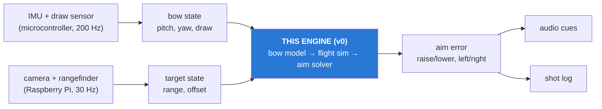

# How the Artemis engine works

A plain-language tour of the code, for everyone on the team: electrical, mechanical, and software.
You don't need to read the code to follow this. File links are there if you want to dig in.

---

## The one-paragraph version

The engine answers one question: **"Given how the bow is drawn and where the target is, which way
should the bow point so the arrow hits the bullseye, and how far off is it right now?"**
It does that in three steps. First, it works out how fast the arrow leaves the bow from how far
the string is pulled back. Second, it simulates the arrow's flight through the air, including
gravity, air drag, and wind. Third, it tries different bow angles until the simulated arrow lands
on the target. The difference between that angle and the bow's current angle is the correction
the archer hears as audio cues.

## Where this fits in the whole project



**v0 is only the blue box.** There are no sensors, camera, or audio yet. Right now you feed it numbers
by hand (or from the exploration scripts), and it tells you the aim error. When the sensors are
ready, their readings plug straight into the same function (see
[Connecting to the real hardware](#connecting-to-the-real-hardware)).

---

## Directions and signs (read this once)

Every number in the code uses this frame. The origin is **the arrow's nock at the moment of release**.

```
         z (up)
         │
         │     y (archer's LEFT)
         │   ╱
         │ ╱
  archer ●──────────────────────► x (downrange, toward the target)
```

| Thing | Positive means |
|---|---|
| **pitch** | arrow points **up** |
| **yaw** | arrow points **left** |
| **roll** | top of the bow tilts right (accepted but ignored in v0) |
| **target height** | above the nock height (a target 20 cm below the nock is `height_m = -0.2`) |
| **wind** `[x, y, z]` | `+y` blows toward the archer's left |

**Errors are always `required − current`.** So `pitch_err_deg = +2.4` means *raise the bow 2.4°*,
and `yaw_err_deg = −1.2` means *turn right 1.2°*. Turning the sign into a word ("raise", "right")
is the cue layer's job later.

**Units:** everything inside the code is SI (meters, kilograms, newtons, seconds), and every variable
name carries its unit: `range_m`, `pitch_deg`, `v_launch_mps`, `arrow_mass_kg`. The only place
inches and pounds appear is `config.yaml`, because that's what a tape measure and luggage scale read.
They get converted once, when the config loads.

---

## The four pieces

```
config.yaml ──► config.py ──► bow.py ──► flight.py ──► aim.py
 (numbers)      (load +       (draw →    (arrow path)  (find the aim,
                 convert)      speed)                   compute error)
```

### 1. Config: [artemis/config.py](../artemis/config.py) + [config.yaml](../config.yaml)

All bow and arrow numbers live in `config.yaml`, never in the physics code. That's deliberate:
we haven't picked or measured our bow yet, so **the bow is data, not code**. Swapping bows means
editing a YAML file, not Python.

The YAML has named **presets** so setups can be compared side by side:

- `recurve_30lb`: a typical 30 lb recurve with real arrows (~53 m/s)
- `toy_suction`: a guess at a toy bow with suction-cup arrows (~14 m/s)

`active_preset` picks the default. Every script also accepts `--preset <name>`.
**All values are placeholders** until we measure the real bow (see
[BOW_CALIBRATION.md](BOW_CALIBRATION.md)).

`load_config()` returns a `Params` object with four parts:

| Part | Holds |
|---|---|
| `params.bow` | force-draw curve, efficiency, arrow mass, nominal draw |
| `params.flight` | gravity, air density, wind, arrow mass/diameter, drag coefficient, launch height |
| `params.solver` | time step, pitch search range, tolerance, iteration limits |
| `params.preset_name` | which preset this is |

`Params` can't be changed in place, which prevents accidental side effects. To try a variation,
make a modified copy: `params.with_flight(wind_mps=(0, 2, 0))` or `params.without_drag()`.

### 2. Bow model: [artemis/physics/bow.py](../artemis/physics/bow.py)

**Question answered: how fast does the arrow leave the bow?**

A bow is a spring. Pulling the string back stores energy in the limbs; releasing it pushes that
energy into the arrow. The model has two steps.

**Stored energy = area under the force-draw curve.** The force-draw curve is a table of
"at this draw length, the string pulls back with this much force", measured with a luggage scale.
The energy stored is the area under that curve from brace height (string at rest) to the current
draw:

```
force │            ●  ← full draw
      │         ●
      │      ●          stored energy = shaded area
      │   ●  ░░░░░░
      │●░░░░░░░░░░░
      └───────────────── draw length
       brace        full
```

`stored_energy_j(draw_m, curve)` computes that area with the trapezoid rule, connecting the
measured points with straight lines. The code **doesn't assume force always rises with draw**.
Compound bows peak in the middle and then "let off" near full draw, and the same code handles
that. If someone draws past the last measured point, it uses the last point and prints a warning
rather than guessing.

**Arrow speed from energy.** Not all of the stored energy reaches the arrow; some goes into moving
the limbs and string, vibration, and noise. The fraction that does reach it is the **efficiency**
(about 0.8 for a decent recurve). Then it's just kinetic energy:

```
½ · arrow_mass · v² = efficiency · stored_energy
v = sqrt(2 · efficiency · stored_energy / arrow_mass)
```

That's `launch_speed_mps(draw_m, bow)`. For `recurve_30lb` at 28 in: **34.7 J stored, 52.7 m/s launch**.

### 3. Flight model: [artemis/physics/flight.py](../artemis/physics/flight.py)

**Question answered: if the arrow leaves at this speed and angle, where does it go?**

The arrow is treated as a **point**: no wobble, no spin, no flex. Two forces act on it:

- **Gravity**: straight down, 9.81 m/s².
- **Air drag**: opposes the arrow's motion *relative to the air*, and grows with speed squared:
  ```
  drag acceleration = −k · |v_rel| · v_rel,   where  v_rel = arrow velocity − wind
                                                     k = ½ · air_density · Cd · area / mass
  ```
  `Cd` (the drag coefficient) is the fudge factor that captures the arrow's shape. It's the least-known
  number in the whole model and gets tuned from real shots. Wind enters through `v_rel`: a crosswind
  makes the air move sideways past the arrow, and drag drags the arrow along with it.

There's no neat formula for a path with drag, so the code **steps through time**. Starting at the
nock, it repeatedly asks "given the current position and velocity, where is the arrow 1 ms later?"
It uses **RK4 (4th-order Runge-Kutta)**, a standard method that samples the forces four times per
step for accuracy. At 1 ms steps, halving the step size moves the impact point by far less than
1 mm, so the steps are small enough.

`simulate(v0, params, x_target_m, dt_s)` runs until one of three things happens:

1. **The arrow reaches the target plane** (x = target range). The exact crossing point usually falls
   between two steps, so it's linearly interpolated.
2. **The arrow hits the ground** (falls more than `launch_height_m` below the nock).
3. **The arrow stops moving forward** (e.g. shot straight up).

It returns a `Trajectory`: the full path (`t, x, y, z, vx, vy, vz` arrays) plus the headline
numbers: whether it hit the target plane, the impact height and sideways offset, the time of
flight, and the impact speed.

`launch_velocity(speed, pitch_deg, yaw_deg)` turns "speed + angles" into a 3D velocity vector
using the sign conventions above.

> **Implementation note:** the integration loop deliberately uses plain Python numbers instead of
> numpy arrays. For a 6-number state that's about 10× faster, which matters because the solver
> runs the simulation ~10–15 times per answer. One simulation takes about 0.5 ms on a laptop.

### 4. Aim solver: [artemis/solver/aim.py](../artemis/solver/aim.py)

**Question answered: which pitch and yaw hit the target, and how far off are we?**

A target is a point: `Target(range_m, lateral_m, height_m)`, relative to the nock.

#### `solve_aim(target, v_launch_mps, params)`: find the aim that hits

This works *backwards* by trial and error, using **bisection** (a guessing game that halves the
search range every time):

1. **Yaw first guess:** point straight at the target, `yaw = atan2(lateral, range)`.
2. **Pitch by bisection:** the search range starts at −15° to +45°.
   - Simulate the middle angle. Arrow lands too low → the answer is in the upper half. Too high →
     lower half.
   - Repeat until the arrow lands within **0.5 mm** of the target height (~15 tries).
   - This only finds the **low arc** (the flat, direct shot), never the high lob.
3. **Fix yaw for wind:** simulate, measure the sideways miss, nudge yaw by `atan(miss / range)`,
   and solve pitch again. Two or three passes is enough. With no wind the first guess is already
   exact, so this step finishes immediately.
4. **Out of reach:** if even the highest angle falls short, it returns `converged=False` with a
   human-readable `reason`. **It never returns a made-up angle.**

One subtlety: with heavy drag (the toy bow), the longest-reaching angle is *below* 45°. Shooting at
45° can fall short even though 40° would reach. When the top of the search range falls short, the
solver scans downward in 2.5° steps to find an angle that reaches before giving up.

It returns an `AimSolution`: `pitch_deg`, `yaw_deg`, `time_of_flight_s`, `impact_speed_mps`,
`converged`, `iterations` (number of simulations used), `reason`, and `yaw_drift_deg` (how much
yaw was added to correct for wind).

**Warm start:** at 50 Hz the target barely moves between frames, so passing last frame's answer
in as `warm_start` lets the solver search a narrow ±0.5° window instead of the full 60°. It reuses
last frame's *wind correction* (`yaw_drift_deg`), not its raw yaw, because the target may have
moved sideways. This cuts the work from ~15 simulations to ~9. If the target jumped too far for
the narrow window, it falls back to the full search automatically.

#### `aim_error(current_pitch, current_yaw, draw_m, target, params)`: how far off are we?

This is **the function the real-time loop will call every frame**. It:

1. Computes the launch speed from the current draw.
2. Solves the required aim (as above).
3. Simulates the **current** aim to predict where the arrow would land *right now*.

It returns an `AimError`:

| Field | Meaning |
|---|---|
| `pitch_err_deg` | required − current pitch. **+ = raise** |
| `yaw_err_deg` | required − current yaw. **+ = turn left** |
| `predicted_impact_y_m`, `predicted_impact_z_m` | where the arrow would hit relative to the bullseye (+left, +up) |
| `predicted_miss_m` | straight-line distance from the bullseye |
| `solution` | the full `AimSolution` (pass it back in as next frame's `warm_start`) |
| `v_launch_mps`, `current_trajectory` | extras, used by the explorer to draw the path |

---

## A worked example

`recurve_30lb`, full 28 in draw, target 15 m away at nock height, no wind, bow currently at 1.0° pitch:

```python
from artemis import load_config
from artemis.solver.aim import Target, aim_error

params = load_config(preset="recurve_30lb")
err = aim_error(current_pitch_deg=1.0, current_yaw_deg=0.0,
                draw_m=params.bow.nominal_draw_m, target=Target(15.0), params=params)
```

What happens inside:

1. **Bow:** 28 in draw → 34.7 J stored × 0.80 efficiency → **52.7 m/s**.
2. **Solver:** bisection finds that **1.56°** of pitch lands the arrow on the bullseye after
   **0.29 s** of flight, arriving at 50.6 m/s. Shot dead level, it would drop 41 cm.
3. **Current aim:** at 1.0° the arrow lands about **15 cm low**.
4. **Result:** `pitch_err_deg ≈ +0.56` → *"raise about half a degree."*

---

## Exploration scripts: [explore/](../explore/)

These scripts use the engine to build intuition. Each one reads `config.yaml`, accepts
`--preset`, and saves plots to `explore/out/`. Results are written up in
[explore/FINDINGS.md](../explore/FINDINGS.md).

| Script | What it shows | Why it matters |
|---|---|---|
| `trajectories` | Arrow arcs at several angles, drag vs no drag | How flat a real arrow's path is |
| `sight_tape` | Required pitch vs range, 3–40 m | The whole 5–40 m range is only ~4° of pitch on the recurve |
| `sensitivity` | How far the hit moves per sensor error | **Tells the electrical team how accurate each sensor must be** |
| `monte_carlo` | 2000 shots with noisy sensors on a target face | Group size you'd get for a given sensor accuracy |
| `explorer` | Interactive sliders (draw, pitch, yaw, range, wind, Cd) | The one to play with |
| `solver_timing` | How long a solve takes | Whether it fits the 20 ms loop budget |

Run any of them from the repo root, e.g. `python3 -m explore.explorer`.

**Headline finding:** pitch and yaw accuracy matter far more than anything else. At 15 m, 1° of
aim error moves the hit 26 cm, while 1 cm of draw error moves it 1.6 cm and 0.5 m of range
error moves it 1.4 cm.

---

## Tests: [tests/](../tests/)

`python3 -m pytest` runs ~70 tests in about 3 seconds. They check the physics against answers
you can work out by hand:

- **Bow:** a straight-line force curve stores exactly ½·F·Δx; compound let-off curves work; drawing
  past the table clamps and warns.
- **Flight:** with drag off, the path matches the textbook projectile formula to within 1 mm. It also
  matches scipy's independent solver to within 1 mm. Halving the time step changes nothing
  meaningful. Drag makes arrows land lower. Wind pushes the arrow the right way.
- **Solver:** with drag off, it matches the exact formula for the required angle to within 0.01°;
  it converges from 3 to 40 m; farther targets need more pitch; unreachable targets say so; a target
  on the left needs positive yaw; warm starts give the same answer faster.

If you change the physics, run the tests. If they fail, either you broke something or the test's
"known answer" needs a second look. Don't just loosen the tolerance.

---

## What the model ignores (on purpose, for now)

| Ignored | Effect | When we might add it |
|---|---|---|
| Arrow flex and wobble ("archer's paradox") | Small sideways offset at release | Absorbed by a yaw offset during calibration |
| Fletching spin, lift | Tiny at these ranges | Probably never |
| Arrow-rest geometry (the arrow starts at the rest, not exactly at the nock) | A small constant angle offset | Absorbed by calibration |
| Bow roll (cant) | Tilting the bow shifts the hit sideways and down | Planned (Phase 3) |
| Efficiency changing with draw length or arrow weight | Constant efficiency assumed | If measurements show it varies |
| Moving targets | Assumes a stationary target | Stretch goal: lead the target by the time of flight, which the engine already computes |

The plan (from the spec) is that **the model starts out a bit wrong and gets tuned from logged
shots**: efficiency, drag coefficient, and sensor alignment get fitted to where real arrows land.

---

## Connecting to the real hardware

`aim_error` was designed so each argument maps to one sensor output:

| `aim_error` argument | Comes from |
|---|---|
| `current_pitch_deg` | IMU (accelerometer + gyro, complementary filter) |
| `current_yaw_deg` | Gyro, corrected each frame by the camera's view of the target |
| `draw_m` | Draw distance sensor (riser to string) |
| `target.range_m` | ToF / lidar rangefinder |
| `target.lateral_m`, `target.height_m` | Camera: the target's pixel offset from image center, times range |
| `warm_start` | Last frame's `err.solution` |

None of that wiring exists yet. That's Phase 3 in `SPEC.md` (fake sensor stream, attitude filter,
cues, 50 Hz main loop, shot log).

---

## Common tasks

**Try a different bow or arrow:** add a preset to `config.yaml` (copy an existing one), then run
`python3 -m explore.sight_tape --preset your_preset`.

**See what a change does:** open the explorer (`python3 -m explore.explorer`) and drag the sliders.

**Use the engine from your own script:**

```python
from artemis import load_config
from artemis.physics.bow import launch_speed_mps
from artemis.solver.aim import Target, solve_aim

params = load_config(preset="recurve_30lb")
v = launch_speed_mps(params.bow.nominal_draw_m, params.bow)
sol = solve_aim(Target(range_m=20.0, lateral_m=0.5), v, params)
print(sol.pitch_deg, sol.yaw_deg, sol.converged)
```

---

## Glossary

| Term | Meaning |
|---|---|
| **Brace height** | Distance from the grip to the string at rest. The start of the force-draw curve. |
| **Draw / draw length** | How far back the string is pulled (here: grip pivot point to string). |
| **Force-draw curve** | Table of string force at each draw length. The bow's "fingerprint". |
| **Let-off** | On compound bows, force drops near full draw so it's easier to hold. |
| **Efficiency** | Fraction of stored energy that ends up as arrow speed (the rest goes into the limbs, string, and noise). |
| **Drag coefficient (Cd)** | Number that captures how "draggy" the arrow's shape is. Tuned from real shots. |
| **Low arc** | The flatter of the two angles that hit a target (the other is a high lob). We only use this one. |
| **Time of flight (TOF)** | Seconds from release to the target. |
| **RK4** | Runge-Kutta 4th order: a standard, accurate way to step a simulation forward in time. |
| **Bisection** | Find an answer by repeatedly halving the range it must be in. |
| **Warm start** | Begin the search near last frame's answer to save time. |
| **Sight tape** | Archer's term for "which angle for which distance". |
| **Holdover** | How far above the target you must aim to compensate for drop. |
